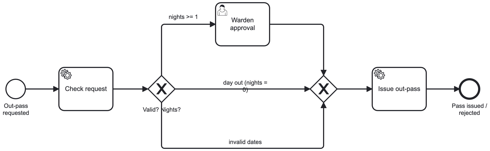
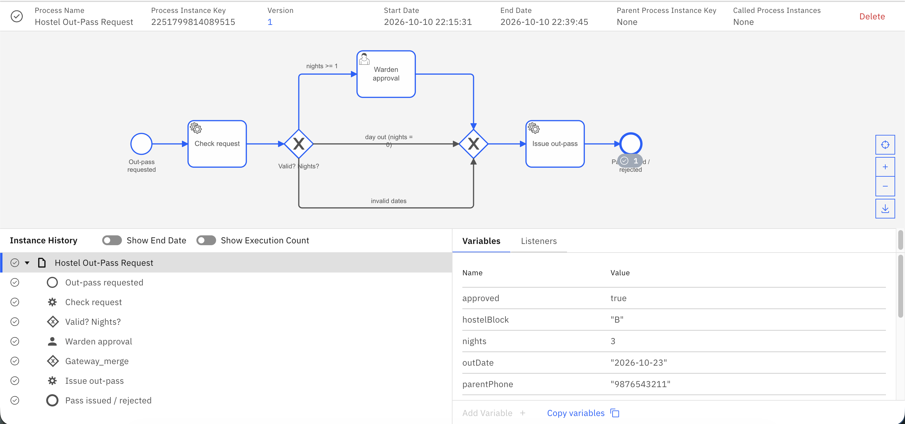
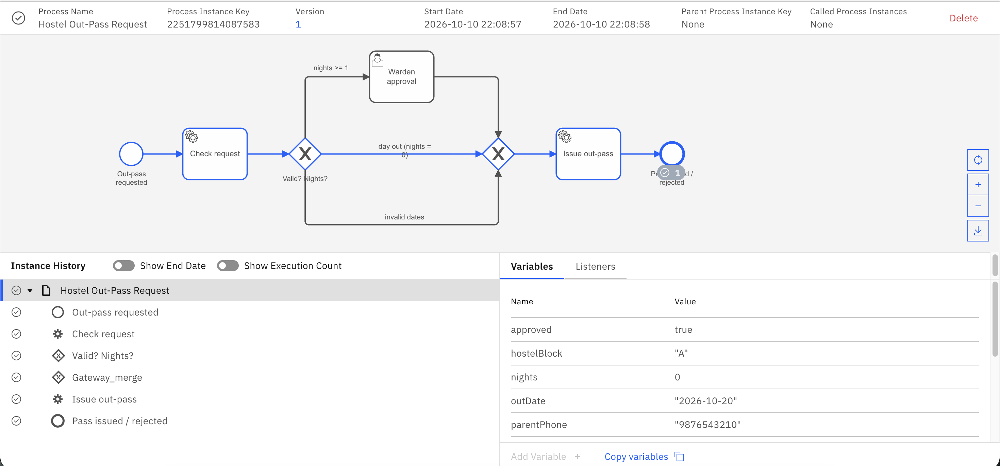
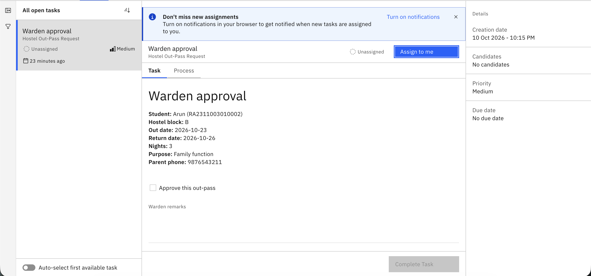
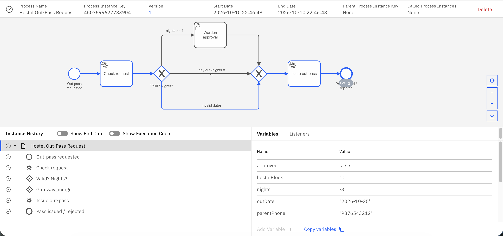

# Camunda Leave Request Workflow

This project models a simple leave/day-out request process using Camunda 8. Day-out requests are approved automatically, requests involving one or more nights are sent to the Warden for review in Tasklist, and requests with invalid dates are rejected.

## Setup and Run

Add your Camunda connection details to `src/main/resources/application.yaml`, then start the application with:

```bash
mvn spring-boot:run
```

## Process Model

The BPMN model for the workflow is shown below.



## Example Runs

### Test A: Automatic Approval

A day-out request follows the automatic approval path.



### Test B: Warden Review

Requests covering one or more nights are routed to the Warden through Tasklist.





### Test C: Invalid Date Rejection

Requests with invalid dates are rejected by the process.


